**Vaishnav Manoj**
MSCS @ University Of Florida · Class of 2028

---

### About

I build backend systems, full stack products, and applied ML tools — focused on turning complex problems into reliable, well-structured software. I care about technical depth, clean architecture, and shipping things that are actually useful.

Currently doing my Masters in CS at University of Florida and looking for **software engineering, backend, full stack, and AI/ML roles/internships** for Summer 2027.

---
## Tech stack

## Featured projects

<table>
<tr>
<td width="50%" valign="top">

### [KeyTalk](https://github.com/vaishnavswe/keytalk)

End-to-end encrypted messaging with wallet-based sign-in and real-time conversations over XMTP.

`Next.js` `XMTP` `RainbowKit` `wagmi`

</td>
<td width="50%" valign="top">

### [Traffic Congestion Predictor](https://github.com/vaishnavswe/TrafficPredictor)

An LSTM forecasts traffic congestion. A FastAPI service serves predictions to an interactive Next.js dashboard.

`PyTorch` `FastAPI` `PostgreSQL` `Next.js` `Docker`

</td>
</tr>
<tr>
<td width="50%" valign="top">

### [SmartHire](https://github.com/vaishnavswe/SmartHire)

A job board that parses resumes into structured candidate profiles for evaluation against specific job postings.

`Python` `Django` `PostgreSQL`

</td>
<td width="50%" valign="top">

### [Credit Card Fraud Detection](https://github.com/vaishnavswe/Creditcard-fraud-detection)

A logistic regression model trained on 280,000+ transactions. A React dashboard shows model performance and surfaces the 200 highest-risk transactions.

`Python` `scikit-learn` `pandas` `React`

</td>
</tr>
</table>

## GitHub activity

  
  

  

