# Vaishnav Manoj

**M.S. in Computer Science · University of Florida · 2028**  
Backend Engineering · Applied ML · Distributed Systems

## About

I build backend services and full-stack applications that put ML models to work. My internship at Arizon Systems combined backend engineering with applied machine learning.

I'm looking for **Summer 2027 internships in backend, full-stack, or applied ML engineering**.

## What I'm working on

- Contributing to the website revamp as a project developer with [GDG at UF](https://ufgdg.com/).
- Exploring distributed systems in Erlang and security for vision-language-action models in robotics.

## Tech stack

## Featured projects

<table>
<tr>
<td width="50%" valign="top">

### [KeyTalk](https://github.com/vaishnavswe/keytalk)

End-to-end encrypted messaging with wallet-based sign-in and real-time conversations over XMTP.

`Next.js` `XMTP` `RainbowKit` `wagmi`

</td>
<td width="50%" valign="top">

### [Traffic Congestion Predictor](https://github.com/vaishnavswe/TrafficPredictor)

An LSTM forecasts traffic congestion. A FastAPI service serves predictions to an interactive Next.js dashboard.

`PyTorch` `FastAPI` `PostgreSQL` `Next.js` `Docker`

</td>
</tr>
<tr>
<td width="50%" valign="top">

### [SmartHire](https://github.com/vaishnavswe/SmartHire)

A job board that parses resumes into structured candidate profiles for evaluation against specific job postings.

`Python` `Django` `PostgreSQL`

</td>
<td width="50%" valign="top">

### [Credit Card Fraud Detection](https://github.com/vaishnavswe/Creditcard-fraud-detection)

A logistic regression model trained on 280,000+ transactions. A React dashboard shows model performance and surfaces the 200 highest-risk transactions.

`Python` `scikit-learn` `pandas` `React`

</td>
</tr>
</table>

## GitHub activity

  
  

  

